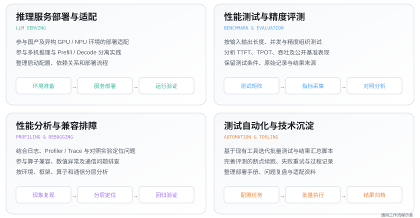
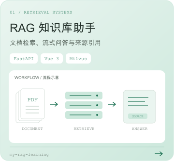
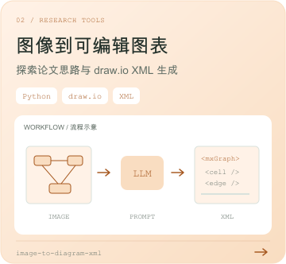
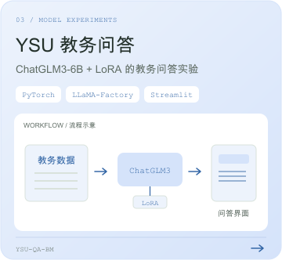
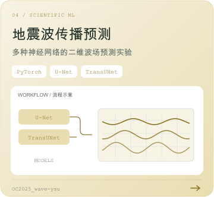

# Hi, I'm YunX 👋

从模型实验，到推理服务与应用实现。关注 AI Infra、大模型应用与科学计算。

## AI Infra · 实习实践

面向国产及异构算力的大模型推理服务，参与部署适配、性能测试、精度评测与工程化工具建设。

  <picture><source media="(max-width: 600px) and (prefers-color-scheme: dark)" srcset="./assets/experience-mobile-dark.svg"><source media="(max-width: 600px)" srcset="./assets/experience-mobile-light.svg"><source media="(prefers-color-scheme: dark)" srcset="./assets/experience-dark.svg"><source media="(prefers-color-scheme: light)" srcset="./assets/experience-light.svg"></picture>

技术实践概述，已按公开展示口径脱密。

## Open Source · 开源贡献

  <a href="https://github.com/search?q=author%3AYunX-a+-user%3AYunX-a&type=pullrequests">
    <picture><source media="(max-width: 600px) and (prefers-color-scheme: dark)" srcset="./assets/oss-contributions-mobile-dark.svg"><source media="(max-width: 600px)" srcset="./assets/oss-contributions-mobile-light.svg"><source media="(prefers-color-scheme: dark)" srcset="./assets/oss-contributions-dark.svg"><source media="(prefers-color-scheme: light)" srcset="./assets/oss-contributions-light.svg"></picture>
  </a>

已合并：[eduagent #24 · 用户管理与认证](https://github.com/im-zhong/eduagent/pull/24) · [#6 · README 更新](https://github.com/im-zhong/eduagent/pull/6)

## Portfolio · 作品集

<a href="https://github.com/YunX-a/my-rag-learning"><picture><source media="(max-width: 600px) and (prefers-color-scheme: dark)" srcset="./assets/rag-mobile-dark.svg"><source media="(max-width: 600px)" srcset="./assets/rag-mobile-light.svg"><source media="(prefers-color-scheme: dark)" srcset="./assets/rag-dark.svg"><source media="(prefers-color-scheme: light)" srcset="./assets/rag-light.svg"></picture></a>
<a href="https://github.com/YunX-a/image-to-diagram-xml"><picture><source media="(max-width: 600px) and (prefers-color-scheme: dark)" srcset="./assets/diagram-mobile-dark.svg"><source media="(max-width: 600px)" srcset="./assets/diagram-mobile-light.svg"><source media="(prefers-color-scheme: dark)" srcset="./assets/diagram-dark.svg"><source media="(prefers-color-scheme: light)" srcset="./assets/diagram-light.svg"></picture></a>
 <a href="https://github.com/YunX-a/YSU-QA-BM"><picture><source media="(max-width: 600px) and (prefers-color-scheme: dark)" srcset="./assets/ysu-mobile-dark.svg"><source media="(max-width: 600px)" srcset="./assets/ysu-mobile-light.svg"><source media="(prefers-color-scheme: dark)" srcset="./assets/ysu-dark.svg"><source media="(prefers-color-scheme: light)" srcset="./assets/ysu-light.svg"></picture></a>
<a href="https://github.com/YunX-a/OC2025_wave-ysu"><picture><source media="(max-width: 600px) and (prefers-color-scheme: dark)" srcset="./assets/wave-mobile-dark.svg"><source media="(max-width: 600px)" srcset="./assets/wave-mobile-light.svg"><source media="(prefers-color-scheme: dark)" srcset="./assets/wave-dark.svg"><source media="(prefers-color-scheme: light)" srcset="./assets/wave-light.svg"></picture></a>

更多实验：[LangChain RAG Bot](https://github.com/YunX-a/langchain-rag-bot) · 文档问答与检索服务。

## Vibe Coding · 氛围编程

  <a href="https://github.com/YunX-a?tab=overview">
    <picture><source media="(max-width: 600px) and (prefers-color-scheme: dark)" srcset="./assets/vibe-coding-mobile-dark.svg"><source media="(max-width: 600px)" srcset="./assets/vibe-coding-mobile-light.svg"><source media="(prefers-color-scheme: dark)" srcset="./assets/vibe-coding-dark.svg"><source media="(prefers-color-scheme: light)" srcset="./assets/vibe-coding-light.svg"></picture>
  </a>

图表为 GitHub 公开贡献快照；更新于 2026-10-28。作品集卡片内为项目示意。

---

## Tech Stack

---

<i>从想法出发，在实验和代码中迭代。</i>

<!-- Layout inspired by https://github.com/PekingSpades/PekingSpades. Assets created for YunX-a. -->
