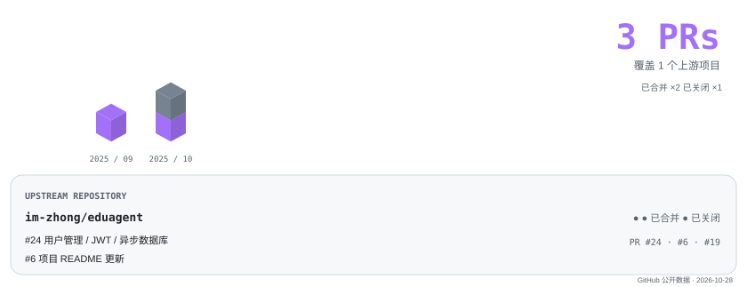
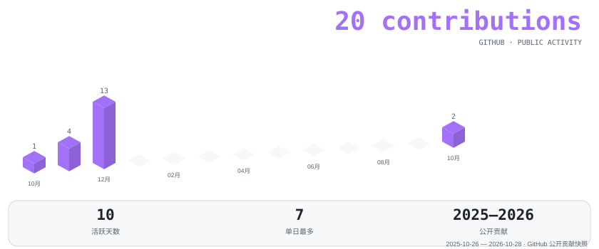

# Hi, I'm YunX 👋

Working on LLM inference and evaluation.

<!-- oss-contributions:start -->
## Open Source · 开源贡献

  <a href="https://github.com/search?q=author%3AYunX-a+-user%3AYunX-a&type=pullrequests">
    <picture><source media="(max-width: 600px) and (prefers-color-scheme: dark)" srcset="./assets/oss-contributions-mobile-dark.svg"><source media="(max-width: 600px)" srcset="./assets/oss-contributions-mobile-light.svg"><source media="(prefers-color-scheme: dark)" srcset="./assets/oss-contributions-dark.svg"><source media="(prefers-color-scheme: light)" srcset="./assets/oss-contributions-light.svg"></picture>
  </a>

<!-- oss-contributions:end -->

<!-- portfolio:start -->
## Portfolio · 作品集

<picture><source media="(max-width: 600px) and (prefers-color-scheme: dark)" srcset="./assets/serving-mobile-dark.svg"><source media="(max-width: 600px)" srcset="./assets/serving-mobile-light.svg"><source media="(prefers-color-scheme: dark)" srcset="./assets/serving-dark.svg"><source media="(prefers-color-scheme: light)" srcset="./assets/serving-light.svg"></picture><picture><source media="(max-width: 600px) and (prefers-color-scheme: dark)" srcset="./assets/evaluation-mobile-dark.svg"><source media="(max-width: 600px)" srcset="./assets/evaluation-mobile-light.svg"><source media="(prefers-color-scheme: dark)" srcset="./assets/evaluation-dark.svg"><source media="(prefers-color-scheme: light)" srcset="./assets/evaluation-light.svg"></picture>

<!-- portfolio:end -->

<!-- vibe-coding:start -->
## Vibe Coding · 氛围编程

  <a href="https://github.com/YunX-a?tab=overview">
    <picture><source media="(max-width: 600px) and (prefers-color-scheme: dark)" srcset="./assets/vibe-coding-mobile-dark.svg"><source media="(max-width: 600px)" srcset="./assets/vibe-coding-mobile-light.svg"><source media="(prefers-color-scheme: dark)" srcset="./assets/vibe-coding-dark.svg"><source media="(prefers-color-scheme: light)" srcset="./assets/vibe-coding-light.svg"></picture>
  </a>

<!-- vibe-coding:end -->

---

## Tech Stack

---

  <i>Focused on inference systems, performance analysis, and evaluation tools.</i>

<!-- Layout inspired by https://github.com/PekingSpades/PekingSpades. Assets created for YunX-a. -->
