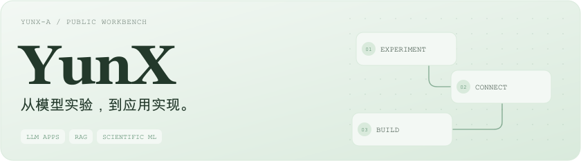

<picture>
  <source media="(max-width: 600px) and (prefers-color-scheme: dark)" srcset="./assets/hero-mobile-dark.svg">
  <source media="(max-width: 600px)" srcset="./assets/hero-mobile-light.svg">
  <source media="(prefers-color-scheme: dark)" srcset="./assets/hero-dark.svg">
  
</picture>

## Projects · 项目

<!-- Fixed-width cards wrap into one column on narrow screens; no custom CSS or external image service. -->

  <a href="https://github.com/YunX-a/my-rag-learning"><picture><source media="(prefers-color-scheme: dark)" srcset="./assets/rag-dark.svg"></picture></a>
  <a href="https://github.com/YunX-a/image-to-diagram-xml"><picture><source media="(prefers-color-scheme: dark)" srcset="./assets/diagram-dark.svg"></picture></a>
   
  <a href="https://github.com/YunX-a/YSU-QA-BM"><picture><source media="(prefers-color-scheme: dark)" srcset="./assets/ysu-dark.svg"></picture></a>
  <a href="https://github.com/YunX-a/OC2025_wave-ysu"><picture><source media="(prefers-color-scheme: dark)" srcset="./assets/wave-dark.svg"></picture></a>

卡片展示的是项目流程示意；实现、环境说明与实验记录见各项目仓库。

更多实验：[LangChain RAG Bot](https://github.com/YunX-a/langchain-rag-bot) · 文档问答与检索服务。

## Open Source · 开源贡献

| 项目 | 工作 | PR |
| --- | --- | --- |
| [eduagent](https://github.com/im-zhong/eduagent) | 基于 fastapi-users 集成用户管理、JWT 认证与异步数据库支持，补充认证流程测试 | [#24 · 已合并](https://github.com/im-zhong/eduagent/pull/24) |
| [eduagent](https://github.com/im-zhong/eduagent) | 更新项目 README | [#6 · 已合并](https://github.com/im-zhong/eduagent/pull/6) |

## Toolbox · 常用工具

`Python` · `FastAPI` · `PyTorch` · `LangChain` · `Vue` · `Docker`

[查看全部仓库](https://github.com/YunX-a?tab=repositories)
